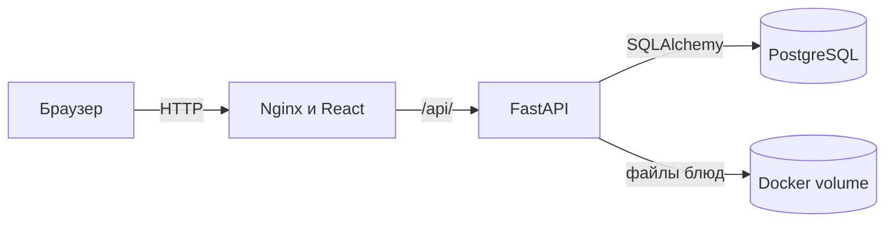
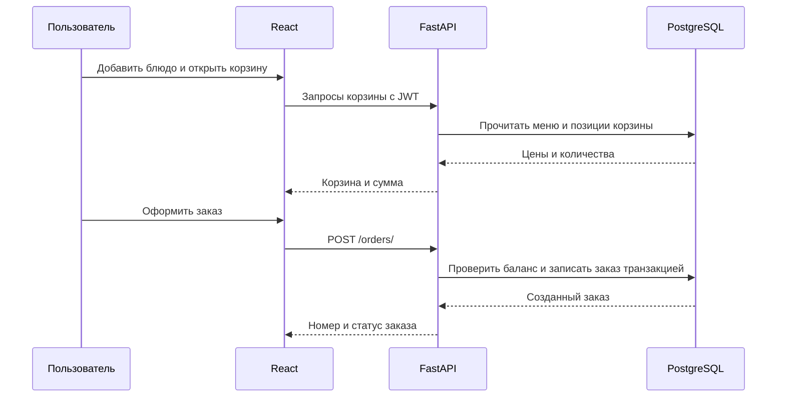

# Архитектура UniFood

Документ к пункту 16 практического занятия: анализ и выбор архитектуры курсового проекта.

## Задача и ограничения

Сервис позволяет гостю смотреть меню, зарегистрированному пользователю собирать корзину и оформлять заказ, а администратору управлять блюдами и заказами. Для учебного проекта важны простой локальный запуск, прозрачное разделение кода и возможность демонстрировать каждую часть отдельно. Внешняя интеграция с iiko не планируется; оплата работает в демонстрационном режиме.

## Выбранное решение

Трёхзвенное веб-приложение: React отвечает за интерфейс, FastAPI предоставляет HTTP API и выполняет бизнес-правила, PostgreSQL хранит данные. Frontend и backend развёрнуты в отдельных контейнерах. Nginx отдаёт собранный frontend и проксирует `/api/` к backend; база доступна только во внутренней сети Docker Compose.

Выбор позволяет отдельно развивать интерфейс, серверные правила и схему данных. PostgreSQL поддерживает внешние ключи, ограничения уникальности и транзакции, необходимые для корзины и заказов. Docker Compose поднимает все три сервиса одной командой и сохраняет данные в томах.

## Границы компонентов

| Компонент | Ответственность | Основной код |
| --- | --- | --- |
| React | Экраны, маршруты, локальное состояние, обращения к API | `frontend/unifood-frontend/src` |
| FastAPI routers | HTTP-маршруты, авторизация и формат ответов | `backend/app/routers`, `backend/app/api` |
| CRUD и services | Работа с данными, оформление заказа и правила статусов | `backend/app/crud`, `backend/app/services` |
| SQLAlchemy models | Таблицы и связи | `backend/app/models` |
| PostgreSQL | Постоянное хранение пользователей, меню, корзин и заказов | `db` в `compose.yaml` |
| Docker volume | Загруженные фотографии блюд | `menu_images` в `compose.yaml` |

Pydantic-схемы в `backend/app/schemas` проверяют вход и определяют ответы API. Backend рассчитывает стоимость заказа и проверяет баланс, поэтому сумма, присланная браузером, не считается источником истины. Пароли хранятся как хеши; запросы защищённых маршрутов несут JWT в заголовке `Authorization`.

## Основной поток заказа

## Компромиссы и границы текущей реализации

- Это один backend-сервис, разделённый на модули. Отдельные микросервисы добавили бы сетевые и эксплуатационные сложности без пользы для текущего масштаба.
- Уведомления и отложенное изменение статуса выполняются локальными фоновыми задачами FastAPI. После перезапуска процесса такие задачи не восстанавливаются; для надёжной очереди потребуется отдельный компонент.
- Схема создаётся из SQLAlchemy-моделей при запуске. Управляемые миграции потребуются при развитии структуры уже заполненной БД.
- Демонстрационная оплата не взаимодействует с банком или кассой. Интеграция с iiko исключена из текущего проекта.

## Проверка решения

`docker compose up --build -d` запускает PostgreSQL, backend и frontend. Проверки работоспособности: `GET /health` на backend, открытие `/menu` в браузере и запросы API через `/api/` на frontend. Данные PostgreSQL и изображения остаются после `docker compose down` без удаления томов.
