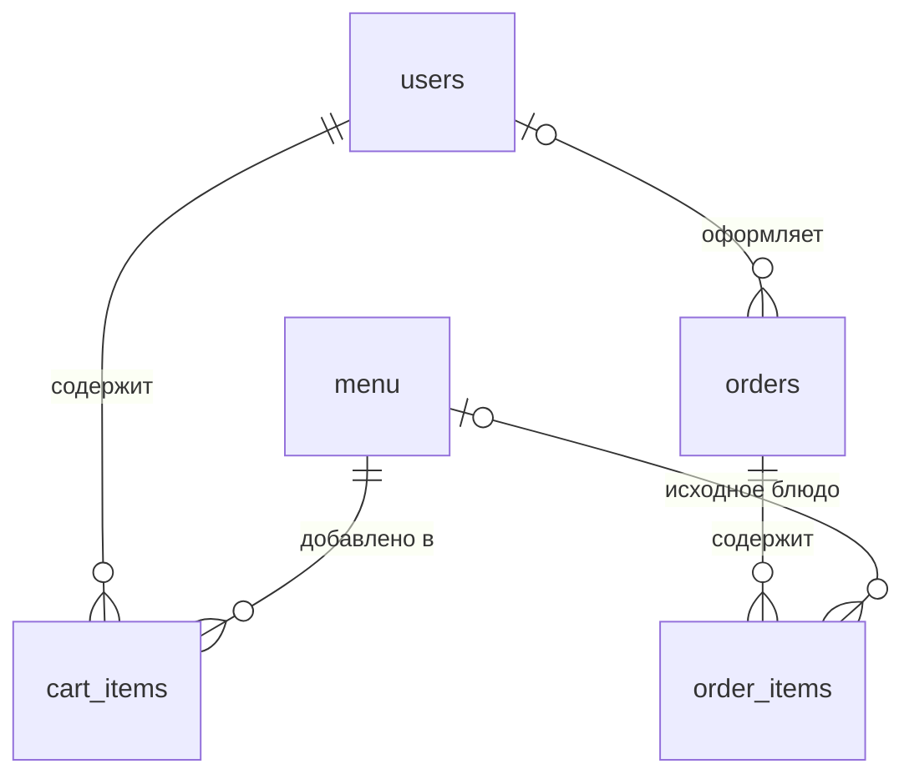

# Схема базы данных UniFood

Документ к пункту 18 практического занятия: схема и структура PostgreSQL. Источник структуры — SQLAlchemy-модели в `backend/app/models`.

## Связи



У заказа может не быть пользователя (гостевой заказ), а у позиции заказа — ссылки на блюдо после удаления этого блюда из меню. Цена на момент заказа остаётся в `order_items.price_at_order`.

## Таблицы

| Таблица | Основные поля | Назначение |
| --- | --- | --- |
| `users` | `id`, `email`, `name`, `hashed_password`, `is_admin`, `balance`, `created_at` | Учётные записи и демонстрационный баланс |
| `menu` | `id`, `food_name`, `price`, `category`, `ingredients`, `description`, `image_url`, `calories`, `created_at`, `updated_at` | Каталог блюд |
| `cart_items` | `id`, `user_id`, `menu_item_id`, `quantity` | Позиции корзины пользователя |
| `orders` | `id`, `user_id`, `total_price`, `status`, `order_number`, `created_at`, `updated_at` | Заказ, его сумма и статус |
| `order_items` | `id`, `order_id`, `menu_item_id`, `quantity`, `price_at_order` | Состав заказа с зафиксированной ценой |

Все `id` — первичные ключи. `users.email` и `orders.order_number` уникальны. Пара `(cart_items.user_id, cart_items.menu_item_id)` уникальна, чтобы одно блюдо не дублировалось в корзине. Статусы заказа: `NEW`, `PREPARING`, `READY`, `COMPLETED`, `CANCELLED` (значения SQLAlchemy Enum в PostgreSQL).

## Внешние ключи и удаление

| Связь | При удалении родителя |
| --- | --- |
| `cart_items.user_id → users.id` | Удалить позиции корзины |
| `cart_items.menu_item_id → menu.id` | Удалить позиции корзины |
| `orders.user_id → users.id` | Оставить заказ, установить `NULL` |
| `order_items.order_id → orders.id` | Удалить позиции заказа |
| `order_items.menu_item_id → menu.id` | Оставить позицию заказа, установить `NULL` |

Суммы и цены сейчас представлены типом `Float` в ORM. Для реальных денежных операций потребуется переход на `NUMERIC` и миграция существующих значений. Схема сейчас создаётся через `Base.metadata.create_all`; это создаёт отсутствующие таблицы, но не изменяет уже существующие. Изменения структуры после появления данных потребуют миграций.

## Проверка в PostgreSQL

После `docker compose up -d` можно посмотреть таблицы и ограничения:

```bash
docker compose exec db psql -U unifood -d unifood -c '\dt'
docker compose exec db psql -U unifood -d unifood -c "SELECT conrelid::regclass, conname, pg_get_constraintdef(oid) FROM pg_constraint WHERE connamespace = 'public'::regnamespace ORDER BY conrelid::regclass::text, conname;"
```
