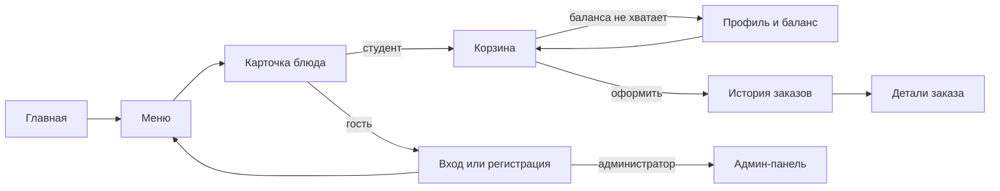

# Проектирование интерфейса UniFood

Документ к пункту 16 практического занятия: сценарии пользователей, структура экранов и правила взаимодействия. Он описывает текущую реализацию React-приложения.

## Пользователи и задачи

| Роль | Главная задача | Основной путь |
| --- | --- | --- |
| Гость | Посмотреть ассортимент и понять, как заказать | Главная → Меню → Карточка блюда → Вход или регистрация |
| Студент | Выбрать блюда и оформить заказ | Меню → Корзина → Проверка суммы и баланса → Заказ → История заказов |
| Администратор | Обновлять меню и обрабатывать заказы | Вход → Админ-панель → Блюда, заказы, пользователи |

## Карта экранов

## Структура и поведение

- **Главная:** кратко объясняет сервис и ведёт к меню. Просмотр меню доступен без входа.
- **Меню:** поиск по названию, описанию, составу и категории; фильтр категорий; карточка с фото, ценой и подробностями. Добавление в корзину требует входа.
- **Корзина:** отдельные представления для широкого и узкого экрана, изменение количества, итоговая сумма и явное действие оформления. Если баланса не хватает, интерфейс показывает недостающую сумму и путь в профиль.
- **Заказы:** список со статусами и отдельный диалог с составом заказа. Пустой список направляет пользователя к меню.
- **Админ-панель:** управление меню и статусами заказов доступно из меню профиля администратора.

## Состояния интерфейса

| Состояние | Что видит пользователь | Действие |
| --- | --- | --- |
| Загрузка меню | Индикатор загрузки | Дождаться ответа |
| Ошибка сети | Сообщение об ошибке | Повторить загрузку |
| Меню пусто | Пояснение без результатов | Вернуться позже |
| Поиск без совпадений | Сообщение о фильтре | Сбросить фильтры |
| Корзина пуста | Пояснение | Перейти в меню |
| Недостаточно средств | Недостающая сумма | Открыть профиль |
| Заказ оформлен | Подтверждение | Посмотреть историю |

## Адаптивность и доступность

- На узком экране навигация сворачивается в боковое меню, а корзина показывает карточки вместо таблицы.
- На широком экране меню использует сетку блюд, корзина — таблицу.
- Основные действия доступны с клавиатуры; ссылка в начале страницы переносит к содержимому. Кнопки только с пиктограммой имеют текстовые названия для вспомогательных технологий.
- Анимация бегущей строки отключается при системной настройке уменьшения движения.

## Проверка сценария

1. Гость открывает меню с главной, просматривает блюдо и видит понятное предложение войти для добавления в корзину.
2. Пользователь ищет блюдо, применяет категорию и сбрасывает фильтры, если совпадений нет.
3. Пользователь оформляет заказ из корзины и видит подтверждение в истории.
4. На ширине мобильного экрана навигация, карточка блюда и корзина остаются удобными для чтения и управления.
